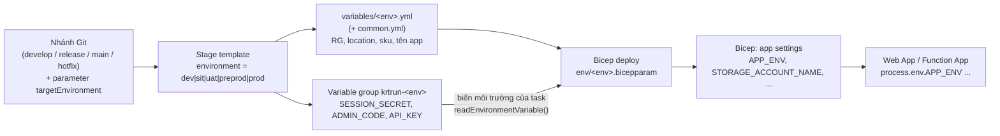
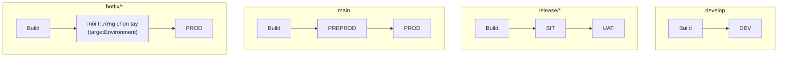

# KRT-run (repo `app`) – Hướng dẫn

Repo này chứa **code ứng dụng**: web **Express (EJS)** + **Azure Function (Node v4)** chạy Node.js 22, dùng Blob / Queue / Table, và pipeline **app-deploy**. Hạ tầng (Bicep + provision) nằm ở repo riêng `infra`.

```
app/
├── AGENTS.md              # luật cho Cursor (giống CLAUDE.md)
├── .cursor/rules/node.mdc
├── web/                   # Express monolith (UI + API + openapi.yaml)
├── function/              # Function xử lý queue upload-jobs
├── pipelines/             # app-deploy.yml, templates/, variables/<env>.yml
└── docs/SETUP_vi.md
```

Luồng nghiệp vụ: Nhân viên upload ảnh + km + ngày chạy → web lưu ảnh vào blob `incoming`, ghi `Runs` (PENDING_PROCESSING), đẩy message vào queue `upload-jobs`, ghi `AuditLog` (UPLOAD) rồi trả về ngay → Function kiểm tra ảnh, chuyển sang blob `proofs`, cập nhật `Runs` (PENDING_REVIEW hoặc REJECTED_INVALID), ghi `AuditLog` (PROCESSED) → Admin duyệt (APPROVED/REJECTED) → bảng xếp hạng chỉ tính km đã duyệt.

---

## 1. Biến môi trường của app

- Đăng ký tài khoản có **mã nhân viên == `ADMIN_CODE`** thì tự thành **admin**.
- Mật khẩu hash bằng bcrypt, bảng `AuditLog` chỉ ghi thêm (append-only).

| Biến | Ý nghĩa | Ví dụ |
|---|---|---|
| `APP_ENV` | Tên môi trường (dev/sit/uat/preprod/prod) | `dev` |
| `STORAGE_ACCOUNT_NAME` | Tên storage trên Azure (dùng managed identity) | `stkrtrundevab12cd` |
| `QUEUE_NAME` | Tên queue | `upload-jobs` |
| `BLOB_CONTAINER_INCOMING` / `BLOB_CONTAINER_PROOFS` | Tên container | `incoming` / `proofs` |
| `TABLE_USERS` / `TABLE_RUNS` / `TABLE_AUDIT` | Tên table | `Users` / `Runs` / `AuditLog` |
| `SESSION_SECRET` | Khoá ký session (**secret**, bắt buộc ở prod) | chuỗi ngẫu nhiên dài |
| `ADMIN_CODE` | Mã nhân viên đăng ký đầu tiên sẽ thành admin (**secret**) | `ADMIN01` |
| `API_KEY` | Key cho APIM gọi `/api/*` qua header `x-api-key` (**secret**) | chuỗi ngẫu nhiên |

`web/src/config` kiểm tra các biến bắt buộc khi khởi động; thiếu là app dừng và báo rõ thiếu gì.

---

## 2. Biến chảy qua từng tầng như thế nào (phần cấu hình app)



Giải thích dễ hiểu (giống việc **gọi món ăn**):
1. **Nhánh Git** là "bàn nào gọi món". Pipeline nhìn tên nhánh để biết phải chạy môi trường nào (hotfix thì bạn chọn tay bằng `targetEnvironment`).
2. Mỗi stage mang tên môi trường, rồi **tự nạp file `variables/<env>.yml`** của đúng môi trường đó (tên resource group, region, SKU, tên web app...). Phần dùng chung nằm ở `common.yml`.
3. **Secret không nằm trong repo.** Chúng nằm trong *variable group* `krtrun-<env>` trên Azure DevOps. Task chuyển chúng thành biến môi trường, file `.bicepparam` đọc bằng `readEnvironmentVariable('SESSION_SECRET', '')`.
4. Mọi giá trị tham số hạ tầng nằm trong file `env/<env>.bicepparam`; `variables/<env>.yml` chỉ giữ tên resource để pipeline dùng, nên phải khớp với bicepparam.
5. Bicep ghi các giá trị đó vào **app settings** của Web App và Function App.
6. Khi chạy, Azure đưa app settings vào **`process.env`**, và `web/src/config` đọc ra.

> **Lưu ý quan trọng:** `sit`, `uat`, `preprod` dùng **chung tài nguyên của dev** (cùng RG, web app, storage). Mỗi lần provision môi trường nào thì `APP_ENV` của web app dev bị đổi thành tên môi trường đó (bản provision cuối cùng thắng). Đây là cách tiết kiệm tiền khi đang học. Khi cần tách thật, đổi `resourceEnv` và tên trong `variables/<env>.yml` + `env/<env>.bicepparam`.

> **Chia việc giữa 2 repo:** app settings (`APP_ENV`, `STORAGE_ACCOUNT_NAME`, secret...) được **repo `infra`** ghi lên Azure khi chạy pipeline provision. Repo `app` chỉ cần biết **tên** web app / function app / APIM để deploy code (nằm trong `pipelines/variables/<env>.yml`). Các tên này phải khớp Bicep: `<prefix>-<resourceEnv>-web|func|apim`.

---

## 3. Nhánh Git → môi trường



| Nhánh | Các stage chạy (tuần tự) | Approval |
|---|---|---|
| `develop` | Build → **DEV** | không |
| `release/*` | Build → **SIT** → **UAT** | UAT |
| `main` | Build → **PREPROD** → **PROD** | PREPROD, PROD |
| `hotfix/*` | Build → **targetEnvironment** (dev/sit/uat/preprod, mặc định dev) → **PROD** | môi trường uat/preprod nếu chọn, và PROD |

Pipeline `pipelines/app-deploy.yml` của repo này theo quy tắc trên (pipeline provision ở repo `infra` có quy tắc giống hệt). Build chỉ chạy **một lần**, các stage deploy dùng lại artifact. Stage deploy là *template* dùng lại: `pipelines/templates/build-node.yml`, `pipelines/templates/deploy-app.yml`.
Approval **không** nằm trong YAML: bạn vào Azure DevOps → Pipelines → Environments → `krtrun-<env>` → Approvals and checks.

---

## 4. Thiết lập Azure DevOps cho repo app (làm một lần)

1. **Tạo repo `app` trên Azure DevOps** rồi đẩy code:
   ```bash
   cd app
   git remote add origin <URL repo app>
   git add . && git commit -m "init KRT-run app"
   git branch -M main && git push -u origin main
   git checkout -b develop && git push -u origin develop
   ```
   (Repo này đã `git init -b develop`, chưa có commit. Nhớ tạo nhánh `main` trước khi dùng luồng release.)
2. **Service connection** (Project settings → Service connections → *Azure Resource Manager* → **Workload identity federation**): `sc-krtrun-dev` và `sc-krtrun-prod` (khớp `serviceConnection` trong `pipelines/variables/<env>.yml`). Có thể dùng chung với repo `infra` nếu cùng project; cần quyền deploy web app / function app / APIM (Contributor trên resource group là đủ).
3. **Environments**: `krtrun-dev`, `krtrun-sit`, `krtrun-uat`, `krtrun-preprod`, `krtrun-prod`; thêm **Approvals** cho `uat`, `preprod`, `prod` (Approvals and checks).
4. **Tạo pipeline** (Pipelines → New → Azure Repos Git → *Existing Azure Pipelines YAML file*): `krtrun-app-deploy` → `/pipelines/app-deploy.yml`.
5. **Điều kiện trước khi chạy**: repo `infra` đã chạy provision cho môi trường tương ứng (nếu chưa có web app thì deploy sẽ lỗi).
6. **Chạy**: merge vào `develop` → pipeline build + test, deploy web + function, import API vào APIM, smoke test `/api/health`.
7. **Hotfix**: tạo nhánh `hotfix/xxx` từ `main`, push, rồi **Run pipeline** chọn nhánh đó và chọn `targetEnvironment`.

Secret (`SESSION_SECRET`, `ADMIN_CODE`, `API_KEY`) **không** nằm ở repo app; chúng thuộc variable group `krtrun-<env>` dùng bởi pipeline provision ở repo `infra`.

---

## 5. Giới hạn hiện tại (nên biết)

- Session lưu trong bộ nhớ (MemoryStore): chỉ ổn với **1 instance**; restart là đăng nhập lại.
- Chưa có giới hạn số lần đăng nhập sai (rate limit).
- F1 (free) chạy Node.js: ~60 phút CPU/ngày, 1GB RAM, không Always On (request đầu tiên chậm). Nếu app dừng vì hết quota thì nâng plan lên B1 trong repo `infra`.
- Pipeline chưa được chạy thật trên Azure (chỉ parse YAML); Function chưa chạy qua `func start` thật trong lúc viết.

## 6. Từ khó

| Từ | Nghĩa |
|---|---|
| Managed identity | "Căn cước" tự động của app để truy cập Azure mà không cần mật khẩu |
| DefaultAzureCredential | Thư viện tự tìm cách đăng nhập vào Azure (managed identity khi chạy trên Azure) |
| Queue trigger | Function tự chạy khi có message mới trong queue |
| Audit log | Nhật ký ghi lại ai làm gì, chỉ thêm, không sửa |
| Service connection | Kết nối cho phép pipeline đăng nhập vào Azure |
| Workload identity federation | Cách service connection đăng nhập không cần lưu mật khẩu/secret |
| Environment (Azure DevOps) | Nơi gắn approval, pipeline phải chờ duyệt trước khi deploy |
| Variable group | Nhóm biến (có thể là secret) dùng chung cho nhiều pipeline |
| Stage / Job / Template | Giai đoạn / công việc / khuôn dùng lại trong pipeline |
| APIM | API Management: cổng đứng trước API, quản lý key, giới hạn, chính sách |
| SKU | Gói dịch vụ (F1 miễn phí, B1 trả phí...) |
| Append-only | Chỉ được thêm bản ghi mới, không sửa/xoá |
| CSRF | Tấn công giả mạo form; app chặn bằng token ẩn trong mỗi form |
