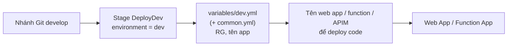
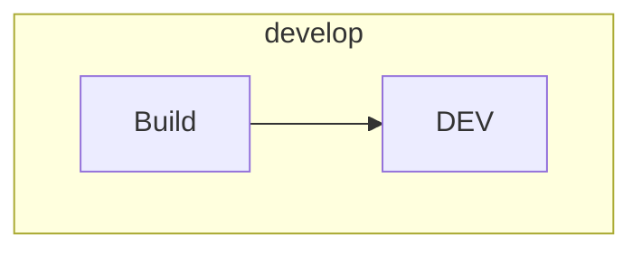

# KRT-run (repo `app`) – Hướng dẫn

Repo này chứa **code ứng dụng**: web **Express (EJS)** + **Azure Function (Node v4)** chạy Node.js 22, dùng Blob / Queue / Table, và pipeline **app-deploy**. Hạ tầng (Bicep + provision) nằm ở repo riêng `infra`.

```
app/
├── AGENTS.md              # luật cho Cursor (giống CLAUDE.md)
├── .cursor/rules/node.mdc
├── web/                   # Express monolith (UI + API + openapi.yaml)
├── function/              # Function xử lý queue upload-jobs
├── pipelines/             # app-deploy.yml, templates/, variables/<env>.yml
└── docs/SETUP_vi.md
```

Luồng nghiệp vụ: Nhân viên upload ảnh + km + ngày chạy → web lưu ảnh vào container `proofs`, thư mục `incoming/`, ghi `Runs` (PENDING_PROCESSING), đẩy message vào queue `upload-jobs`, ghi `AuditLog` (UPLOAD) rồi trả về ngay → Function kiểm tra ảnh, chuyển sang thư mục `processed/` (cùng container), cập nhật `Runs` (PENDING_REVIEW hoặc REJECTED_INVALID), ghi `AuditLog` (PROCESSED) → Admin duyệt (APPROVED/REJECTED) → bảng xếp hạng chỉ tính km đã duyệt.

---

## 1. Biến môi trường của app

- Đăng ký tài khoản có **mã nhân viên == `ADMIN_CODE`** thì tự thành **admin**.
- Mật khẩu hash bằng bcrypt, bảng `AuditLog` chỉ ghi thêm (append-only).

| Biến | Ý nghĩa | Ví dụ |
|---|---|---|
| `APP_ENV` | Tên môi trường (hiện dùng `dev`; app vẫn nhận sit/uat/preprod/prod để sau này mở rộng) | `dev` |
| `STORAGE_ACCOUNT_NAME` | Tên storage trên Azure (dùng managed identity) | `stkrtrundevab12cd` |
| `QUEUE_NAME` | Tên queue | `upload-jobs` |
| `BLOB_CONTAINER` | Tên container duy nhất chứa ảnh. Ảnh mới nằm ở `incoming/`, ảnh đã xử lý nằm ở `processed/` | `proofs` |
| `TABLE_USERS` / `TABLE_RUNS` / `TABLE_AUDIT` | Tên table | `Users` / `Runs` / `AuditLog` |
| `SESSION_SECRET` | Khoá ký session (**secret**, bắt buộc khi `APP_ENV=prod`) | chuỗi ngẫu nhiên dài |
| `ADMIN_CODE` | Mã nhân viên đăng ký đầu tiên sẽ thành admin (**secret**) | `ADMIN01` |
| `API_KEY` | Key cho APIM gọi `/api/*` qua header `x-api-key` (**secret**) | chuỗi ngẫu nhiên |

`web/src/config` kiểm tra các biến bắt buộc khi khởi động; thiếu là app dừng và báo rõ thiếu gì.

---

## 2. Biến chảy qua từng tầng như thế nào (phần cấu hình app)



Giải thích dễ hiểu (giống việc **gọi món ăn**):
1. **Nhánh Git** là "bàn nào gọi món". Hiện chỉ có nhánh `develop`, pipeline chạy Build rồi deploy **DEV**.
2. Stage DeployDev **tự nạp file `variables/dev.yml`** (tên resource group, region, tên web app...) và phần dùng chung ở `common.yml`.
3. **Secret không nằm trong repo app.** Chúng thuộc *variable group* `krtrun-dev` trên Azure DevOps, do pipeline provision ở repo `infra` ghi vào app settings.
4. Repo `app` chỉ cần biết **tên** web app / function app / APIM để deploy code (nằm trong `pipelines/variables/dev.yml`). Các tên này phải khớp Bicep: `<prefix>-<resourceEnv>-web|func|apim`.
5. Khi chạy, Azure đưa app settings vào **`process.env`**, và `web/src/config` đọc ra.

> **Chia việc giữa 2 repo:** app settings (`APP_ENV`, `STORAGE_ACCOUNT_NAME`, secret...) được **repo `infra`** ghi lên Azure khi chạy pipeline provision. Repo `app` chỉ cần biết **tên** web app / function app / APIM để deploy code. Các tên này phải khớp Bicep: `<prefix>-<resourceEnv>-web|func|apim`.

---

## 3. Nhánh Git → môi trường



| Nhánh | Các stage chạy (tuần tự) | Approval |
|---|---|---|
| `develop` | Build → **DEV** | Environment `krtrun-dev` |

Hiện chỉ môi trường **dev** đang dùng. Pipeline `pipelines/app-deploy.yml` của repo này theo quy tắc trên (pipeline provision ở repo `infra` cũng vậy). Build chỉ chạy **một lần**, stage deploy dùng lại artifact. Stage deploy là *template* dùng lại: `pipelines/templates/build-node.yml`, `pipelines/templates/deploy-app.yml`.
Approval **không** nằm trong YAML: bạn vào Azure DevOps → Pipelines → Environments → `krtrun-dev` → Approvals and checks, rồi bật Approvals.

Nhánh tính năng (`feature/<tên>`) cắt từ `develop` và merge lại bằng pull request.

> **Sau này muốn thêm môi trường:** thêm file `pipelines/variables/<env>.yml`, thêm một stage trong pipeline, rồi tạo Environment (và variable group nếu cần) trên Azure DevOps. Ở repo `infra` còn phải thêm `bicep/env/<env>.bicepparam` và một stage provision.

---

## 4. Thiết lập Azure DevOps cho repo app (làm một lần)

Code đã nằm trên GitHub, nhánh `develop`: [https://github.com/qlap04/KRT-run-app](https://github.com/qlap04/KRT-run-app). Không cần tạo repo Azure Repos hay push lại.

1. **Service connection** (Project settings → Service connections → *Azure Resource Manager* → **Workload identity federation**): tạo `sc-krtrun-dev`. Tên phải khớp `serviceConnection` truyền vào template trong `pipelines/app-deploy.yml`. Có thể dùng chung với repo `infra` nếu cùng project; cần quyền deploy web app / function app / APIM (Contributor trên resource group là đủ).
2. **Environments**: chỉ cần `krtrun-dev`; vào Approvals and checks rồi **bật Approvals**.
3. **Tạo pipeline** (Pipelines → New pipeline → chọn **GitHub (YAML)** → chọn repo `qlap04/KRT-run-app` → *Existing Azure Pipelines YAML file*): `krtrun-app-deploy` → `/pipelines/app-deploy.yml`. Lần đầu Azure DevOps sẽ xin quyền truy cập GitHub.
4. **Điều kiện trước khi chạy**: repo `infra` đã chạy provision cho **dev** (nếu chưa có web app thì deploy sẽ lỗi).
5. **Chạy**: đẩy hoặc merge vào `develop` → pipeline build + test, deploy web + function, import API vào APIM, smoke test `/api/health`. Stage deploy sẽ chờ bạn Approve trên environment `krtrun-dev`.

Secret (`SESSION_SECRET`, `ADMIN_CODE`, `API_KEY`) **không** nằm ở repo app; chúng thuộc variable group `krtrun-dev` dùng bởi pipeline provision ở repo `infra`.

---

## 5. Chạy test

Có 2 loại test, dùng `node:test` (không cần thêm thư viện):

| Loại | Lệnh | Cần gì |
|---|---|---|
| **Unit test** (trong `web/` và `function/`) | `npm run test:unit` | Không cần gì. Không dùng mạng, không đọc biến môi trường thật. Storage được thay bằng đồ giả (mock). |
| **Integration test** (chỉ trong `web/`) | `npm run test:integration` | Cần storage emulator (Azurite) và biến `STORAGE_CONNECTION_STRING`. |

Quy tắc cho dễ nhớ:
- **Không ghi cứng** connection string hay secret trong file test. Mọi cấu hình của integration test lấy từ biến môi trường. Mật khẩu, session secret và API key của test được tạo ngẫu nhiên lúc chạy.
- Nếu chưa có `STORAGE_CONNECTION_STRING` thì integration test **tự bỏ qua** và in lý do. Đặt `INTEGRATION_REQUIRED=true` nếu muốn nó báo lỗi thay vì bỏ qua (pipeline đang đặt như vậy).
- Mỗi lần chạy, test tạo container, queue, table có **tên ngẫu nhiên** và **xoá hết** khi xong, nên chạy nhiều lần không bị lẫn dữ liệu. Mỗi test tự tạo user riêng nên không phụ thuộc test khác.
- Trên production **không chạy** unit hay integration test. Sau khi deploy chỉ chạy smoke test `/api/health`.

Chạy integration test trên máy bạn (cần Docker):

```bash
docker run -d --name storage-emulator -p 10000-10002:10000-10002 \
  mcr.microsoft.com/azure-storage/azurite \
  azurite --skipApiVersionCheck --blobHost 0.0.0.0 --queueHost 0.0.0.0 --tableHost 0.0.0.0
cd web
STORAGE_CONNECTION_STRING=UseDevelopmentStorage=true npm run test:integration
docker rm -f storage-emulator
```

Trong pipeline, kết quả test được lưu ở `test-results/*.xml` (JUnit) và hiện ở tab Tests.

---

## 6. Giới hạn hiện tại (nên biết)

- Session lưu trong bộ nhớ (MemoryStore): chỉ ổn với **1 instance**; restart là đăng nhập lại.
- Chưa có giới hạn số lần đăng nhập sai (rate limit).
- F1 (free) chạy Node.js: ~60 phút CPU/ngày, 1GB RAM, không Always On (request đầu tiên chậm). Nếu app dừng vì hết quota thì nâng plan lên B1 trong repo `infra`.
- Pipeline chưa được chạy thật trên Azure (chỉ parse YAML); Function chưa chạy qua `func start` thật trong lúc viết.

## 7. Từ khó

| Từ | Nghĩa |
|---|---|
| Managed identity | "Căn cước" tự động của app để truy cập Azure mà không cần mật khẩu |
| DefaultAzureCredential | Thư viện tự tìm cách đăng nhập vào Azure (managed identity khi chạy trên Azure) |
| Queue trigger | Function tự chạy khi có message mới trong queue |
| Audit log | Nhật ký ghi lại ai làm gì, chỉ thêm, không sửa |
| Service connection | Kết nối cho phép pipeline đăng nhập vào Azure |
| Workload identity federation | Cách service connection đăng nhập không cần lưu mật khẩu/secret |
| Environment (Azure DevOps) | Nơi gắn approval, pipeline phải chờ duyệt trước khi deploy |
| Variable group | Nhóm biến (có thể là secret) dùng chung cho nhiều pipeline |
| Stage / Job / Template | Giai đoạn / công việc / khuôn dùng lại trong pipeline |
| APIM | API Management: cổng đứng trước API, quản lý key, giới hạn, chính sách |
| SKU | Gói dịch vụ (F1 miễn phí, B1 trả phí...) |
| Append-only | Chỉ được thêm bản ghi mới, không sửa/xoá |
| CSRF | Tấn công giả mạo form; app chặn bằng token ẩn trong mỗi form |
